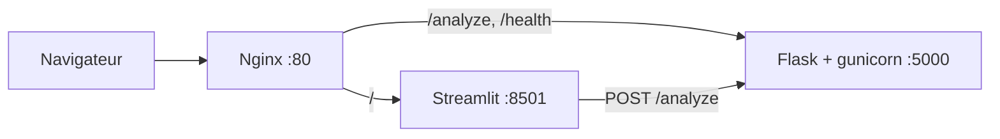
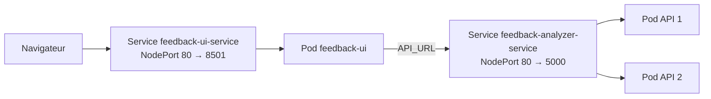
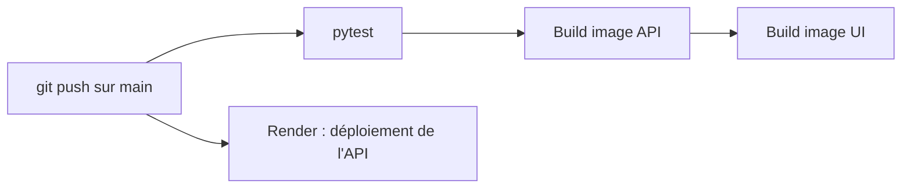

# Feedback Analyzer

API REST d'analyse de sentiment avec interface web, packagée dans un pipeline DevOps complet : conteneurs, reverse proxy, CI/CD et orchestration Kubernetes.


<!-- Ajoute ici une capture d'écran de l'interface : -->
<!--  -->

## Fonctionnalités

- **API Flask** : analyse le sentiment d'un texte avec [VADER](https://github.com/cjhutto/vaderSentiment) (positif, négatif ou neutre, avec le score composé entre -1 et +1).
- **Interface Streamlit** : zone de texte, résultat coloré et jauge du score.
- **Tests automatisés** avec pytest.
- **Conteneurisation** avec Docker (API servie par gunicorn).
- **Orchestration locale** avec Docker Compose et Nginx en reverse proxy (WebSockets inclus pour Streamlit).
- **CI GitHub Actions** : tests, build des images API et UI.
- **Déploiement continu** de l'API sur Render.
- **Kubernetes (Minikube)** : Deployments, Services, self-healing et scaling par replicas.

> VADER est conçu pour l'**anglais**. Un texte en français sera le plus souvent classé « neutral ».

## Architecture

### Docker Compose



Seul Nginx est exposé (port 80). L'API et l'UI ne sont joignables qu'à l'intérieur du réseau Compose.

### Kubernetes



L'API tourne avec 2 replicas derrière un Service. L'UI l'appelle par son nom DNS interne.

### Pipeline CI/CD



## Structure du projet

```
feedback-analyzer/
├── app/                    # API Flask (analyse VADER)
├── tests/                  # Tests pytest
├── ui/                     # Interface Streamlit
│   ├── streamlit_app.py
│   ├── requirements.txt
│   ├── Dockerfile
│   └── .dockerignore
├── docker/
│   └── nginx.conf          # Reverse proxy (API + Streamlit/WebSockets)
├── k8s/                    # Manifests Kubernetes (API et UI)
├── .github/workflows/
│   └── ci.yml              # Pipeline CI
├── Dockerfile              # Image de l'API
├── docker-compose.yml      # API + UI + Nginx
└── requirements.txt        # Dépendances de l'API
```

## API

| Méthode | Route      | Description                 |
|---------|------------|-----------------------------|
| GET     | `/health`  | Vérification de l'état      |
| POST    | `/analyze` | Analyse le sentiment d'un texte |

Exemple :

```bash
curl -X POST http://localhost/analyze \
  -H "Content-Type: application/json" \
  -d '{"text": "I love this product, it is amazing!"}'
```

Réponse :

```json
{
  "text": "I love this product, it is amazing!",
  "sentiment": "positive",
  "score": 0.8516
}
```

Règle de classification sur le score composé : `>= 0.05` positif, `<= -0.05` négatif, sinon neutre.

## Lancer le projet

### Prérequis

- Python 3.11+
- Docker et Docker Compose
- Minikube et kubectl (pour la partie Kubernetes)

### 1. En local, sans Docker

```bash
# API
pip install -r requirements.txt
python -m pytest
# lancer l'API (adapte au point d'entrée de ton dossier app/)
# → http://localhost:5000

# UI (dans un autre terminal)
cd ui
python -m venv .venv
source .venv/bin/activate        # Windows : .venv\Scripts\Activate.ps1
pip install -r requirements.txt
streamlit run streamlit_app.py   # → http://localhost:8501
```

L'UI lit l'adresse de l'API dans la variable d'environnement `API_URL` (par défaut `http://localhost:5000`).

### 2. Avec Docker Compose

```bash
docker compose up --build
```

- Interface : <http://localhost>
- Santé de l'API : <http://localhost/health>

Arrêt : `docker compose down`.

### 3. Sur Kubernetes (Minikube)

```bash
minikube start

# Les manifests utilisent imagePullPolicy: Never : les images doivent être dans Minikube
docker build -t feedback-analyzer:latest .
docker build -t feedback-ui:latest ./ui
minikube image load feedback-analyzer:latest
minikube image load feedback-ui:latest

kubectl apply -f k8s/
kubectl get pods

# Accéder à l'interface
kubectl port-forward svc/feedback-ui-service 8501:80
# → http://localhost:8501
```

#### Vérifier le self-healing

```bash
kubectl delete pod <nom-d-un-pod-api>
kubectl get pods -w        # un nouveau pod est recréé automatiquement
```

#### Vérifier le scaling

```bash
kubectl scale deployment feedback-analyzer --replicas=4
kubectl get pods
```

## CI/CD

Le workflow `.github/workflows/ci.yml` se déclenche sur chaque push et pull request vers `main` :

1. installation des dépendances,
2. exécution des tests pytest,
3. build de l'image Docker de l'API,
4. build de l'image Docker de l'UI.

Le déploiement de l'API sur Render se fait automatiquement à chaque push sur `main`.

**Démo en ligne (API)** : _ajoute ici l'URL Render_ (par exemple `https://ton-service.onrender.com/health`).

## Choix techniques

- **VADER** : léger et sans entraînement, adapté à un projet centré sur le pipeline plutôt que sur le NLP.
- **Deux fichiers `requirements.txt`** : l'image de l'API reste légère, sans pandas ni numpy (embarqués par Streamlit).
- **Nginx devant Streamlit** : nécessite les en-têtes `Upgrade` et `Connection` pour les WebSockets.
- **Pas de Nginx sur Kubernetes** : un Service NodePort suffit, et l'UI joint l'API via le DNS interne du cluster.

## Pistes d'amélioration

- Historique des analyses et graphique de répartition des sentiments dans l'UI
- Import d'un CSV de retours clients
- Support du français par traduction automatique avant analyse
- Autoscaling (HPA) avec test de charge
- Monitoring avec Prometheus et Grafana
- Smoke test Docker Compose dans la CI
- Ingress et Helm pour Kubernetes

## Auteur

**Eya Ben Maiz** : [GitHub](https://github.com/eyabenmaiz)
